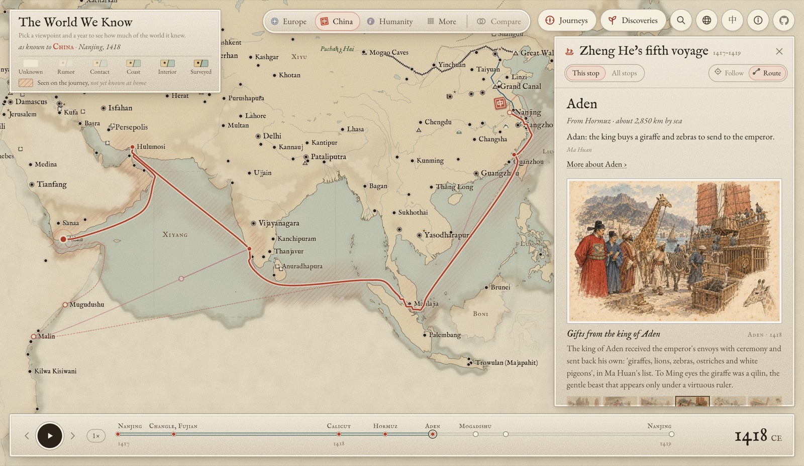
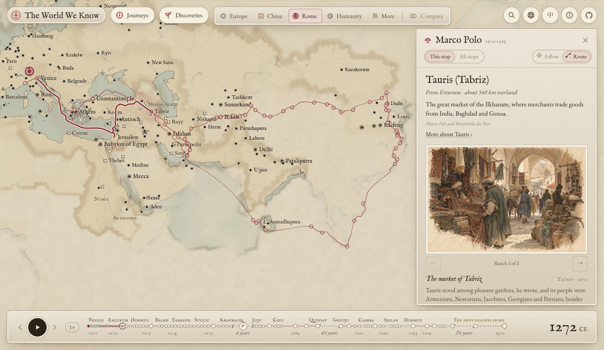

# The World We Know

**English** · [中文](README.zh.md)

**An atlas of who knew what, and when.** Pick a culture and a year, and the map shows how much of the world that culture knew. Fog covers the rest. Follow the travellers who pushed knowledge outward, and watch the fog lift when their news reaches home, or come back when knowledge is lost.

**[Open the atlas →](https://greenere.github.io/the-world-we-know/)** · in English and Chinese · runs in any modern browser





## What's in it

- **34 viewpoints.** Each has its own history of what it knew, from 2000 BCE to today:
  - **China, Korea, Japan, the Mongolian steppe, India, Nusantara.**
  - **Persia, Arabia, Egypt, the Maghreb, the Turks.**
  - **The Sahel, Ethiopia, the Swahili coast, Kongo, Southern Africa.**
  - **The Haudenosaunee, the Mississippian world, the Mexica, the Maya, the Inca, the Inuit, Polynesia.**
  - **Greece, Rome, Iberia, France, Britain, Germany, the Norse, Russia.**
  - **Two knowledge communities,** Europe and the Islamic world. Each shares what its members knew.
  - **Humanity,** which traces where people first arrived, back 70,000 years.
- **184 journeys.** Voyages, pilgrimages, campaigns, scientific expeditions and the last frontiers, from the Sahara and Siberia to the Canadian Arctic. Each is routed over land, sea and river, and tied to what each viewpoint learned from it and when the news reached home. Many come with illustrated sketchbooks. A party sent out from a larger journey (Gan Ying from Ban Chao's, Marco Polo's mission to Yunnan from his own) is a journey of its own, nested under the one it belongs to.
- **148 landmarks, 50 ruins that were never lost, and 69 lost cities found again.**
  - Pyramids, walls, waterfalls and volcanoes, each known to a viewpoint only when it lived nearby, met the place itself, or the place became famous.
  - Some cover ground: deserts, salt flats and lakes that shrink over the centuries, drawn in their real outlines.
  - Ruins stay known to the people who lived beside them: Teotihuacan, Great Zimbabwe and Angkor are listed apart from the cities the world forgot and found again.
  - Some appear only late. Peru's Rainbow Mountain shows its colours from 2013, when its ice melted.
  - Some change with time. The Great Wall is drawn through nine dynasties, each wall in ink while it stood and fading the longer it has lain in ruin. The Grand Canal re-routes age by age.
  - Wonders within a city (the Alhambra in Granada) are listed on their city's card.
- **82 inventions** that changed how people saw the world, from the spoked-wheel chariot to GPS. Those made in a city are listed on its card.
- **35 plants and animals**, and how word of them spread: maize from Mexico to China, tea to Europe by caravan and by sea, the giraffe greeted as a qilin at the Ming court, the dodo and the moa lost. Each has the year every viewpoint came to know it, and its arrivals marked on the map.
- **505 cities** that rise, fall to ruin, are forgotten and are found again, named as each viewpoint named them.
- **Two panels.** Journeys holds the journeys and landmarks; Discoveries holds the inventions and the plants and animals.
- **Compare mode** for two viewpoints, a globe as well as the flat map, and a timeline marked with shared eras: from Out of Africa to One shared map. While you follow a journey, the timeline becomes the journey's own: land and sea legs, long stays folded with their length, and the news reaching home.

Every view is a link: `?vp=china&year=1420`, `?vp=europe,china&year=1420`, `?journey=zhenghe&stop=4`, `?city=loulan`, `?invention=magnetic-compass`, `?living=maize&vp=china`, `&globe=1`, `&lang=zh`.

Keys: ← → key moments or journey stops · Shift ← → one year · Space play · `/` search · Esc close.

## How knowledge is modelled

The atlas is a grid of about 41,000 hexagonal cells (H3, resolution 3). For each viewpoint, every cell has a history of knowledge levels:

| Level | Meaning |
| --- | --- |
| 0 | Unknown |
| 1 | Rumour |
| 2 | Contact |
| 3 | Coast charted |
| 4 | Interior mapped |
| 5 | Surveyed |

Humanity uses its own scale, from "no one yet" to "inhabited".

That history is written region by region in [`data/knowledge.csv`](data/knowledge.csv), one row per change, and every row has a source and a confidence. Journeys add knowledge of their own. A journey says which regions each viewpoint came to know, at what level, and when the news got home.

The build then:
- applies the rule that knowing a shore means knowing the water off it;
- merges the members of the knowledge communities;
- compiles everything into compact per-cell change points that the browser animates as fog.

A few principles run through the data:

- **Knowledge can be lost.** A level can drop. The Norse colonies in Greenland fall silent, and Europe's map of it goes back to rumour.
- **Communities share, they don't conquer.** A member knows what its community knows while it belongs, and what it brought in stays known unless there is evidence it was forgotten.
- **Knowing a region is not knowing what is in it.** A landmark is known to the people who lived near it, to those with a recorded encounter (Xuanzang at Bamiyan in 630, Livingstone at Victoria Falls in 1855), and to everyone else only once it became widely known. A plant or animal is known from where it was first grown or met, to each viewpoint from its own arrival or encounter, and to the rest once it became widely known.
- **Every claim is sourced.** The build refuses events, stops, cities or landmarks without a source and a confidence.

## Running it locally

You need [Node.js](https://nodejs.org/) 20+ and [uv](https://docs.astral.sh/uv/). uv sets up the Python build environment (`h3`, `shapely`, `scipy`) by itself.

```sh
npm install
npm run data     # compile data/ into public/data/ (downloads Natural Earth and ETOPO5 once)
npm run dev      # http://localhost:5173
```

| Command | Does |
| --- | --- |
| `npm run data` | Validates and compiles everything in `data/`, routes every journey, and reports Chinese translation coverage |
| `npm run build` | Type-checks and writes the static site to `dist/` |
| `npm run typecheck` | Type-checks only |
| `npm test` | Runs the unit tests |

The site is fully static, so `dist/` can be hosted anywhere. (`npm run deploy` is the maintainer's script for publishing to GitHub Pages.)

## Project layout

```
data/            everything the map shows, authored as plain text (the files to edit)
scripts/         build_data.py (the data compiler), routes.py (journey routing), generate_images.py (sketches)
src/fog/         the H3 mesh, the fog field and the custom fog layer
src/map/         basemap style and the deck.gl overlay (cities, landmarks, routes, labels)
src/ui/          top bar, timeline, cards, the Journeys and Discoveries panel, search
src/main.ts      wiring: state, playback, camera, input, links
public/data/     build output (generated, not committed)
docs/            the original spec and guides for research and image generation
```

The map is drawn with [MapLibre GL](https://maplibre.org/) and [deck.gl](https://deck.gl/). The fog is one triangle mesh over the whole grid, blended on the GPU into soft, cloudy frontiers. The interface is plain TypeScript, with no framework.

## The data

| File | Holds |
| --- | --- |
| `viewpoints.json` | Each viewpoint's names, colours, homes over time, key moments and community memberships |
| `regions.geojson` | About 220 named regions; coarse polygons are fine at this grid size |
| `knowledge.csv` | `viewpoint, region, year, level, confidence, source, note`; a year can be a range (`1000..1100`), and `=n` holds a level exactly |
| `journeys/<id>.json` | Stops, how each leg was travelled, and what each viewpoint learned |
| `cities.csv` | Founded, peak, abandoned, forgotten and rediscovered dates, with a story |
| `landmarks.csv` | Built and natural landmarks: dates, first encounters (`found`), when each became widely known (`widely`), story |
| `landmark-paths.json` | Courses of walls, canals and canyons, and the ages of those rebuilt over time |
| `inventions.json` | Instruments and ideas: when, where, who, what they changed, and the city they were made in |
| `living.json` | Plants and animals: origin, which viewpoints knew them from the start, and dated arrivals and encounters |
| `names.csv` | What each viewpoint called each place, and when |
| `sources.csv` | Every source cited, with its full citation |
| `depictions/` | The imagined sketches for cities, journeys and inventions, with their prompts and sources |
| `i18n/zh/` | Chinese for all of the above; interface text is in `src/i18n-zh.ts` |

The CSV files open with comments explaining their conventions, and the build checks every cross-reference.

## Accuracy, and what the pictures are

This is a work of synthesis. Dates and extents are approximate, and many rows still cite `draft` or `draft-urban`: placeholders meaning "from general knowledge, awaiting a source". Replacing them with real citations is one of the most useful contributions anyone can make. Legendary journeys such as the Odyssey are labelled as illustrative.

The sketches of cities, journey scenes and inventions are **imagined illustrations made with an image model.** They are not historical images, and each is labelled as an imagined sketch on the card. Each one records the prompt it was made from and the sources its details follow. See [docs/image-api-guide.md](docs/image-api-guide.md) for how they are made.

## Contributing

Corrections, sources and new material are all welcome. Good first contributions:

- **Cite a source.** Find a `draft` row in `knowledge.csv`, `cities.csv` or `landmarks.csv`, add the work to `sources.csv`, and use its id.
- **Correct a viewpoint.** If you know a culture's history well, check its timeline in the atlas against what you know. Every viewpoint would benefit from review by someone who knows it well, ideally from within that tradition.
- **Add a journey, landmark, invention, plant or animal.** Copy an existing entry as a template, run `npm run data`, and the build will tell you what's missing.
- **Translate.** Chinese coverage is complete; the structure in `data/i18n/` and `src/i18n-zh.ts` is the template for other languages.

Please run `npm run data` and `npm run build` before opening a pull request; both must pass.

## License

- **Code:** [Mozilla Public License 2.0](LICENSE). You may use it in any project, open or closed; changes to these files themselves must stay open under the same license.
- **The authored content of `data/`:** [CC BY 4.0](data/LICENSE.md). This covers the knowledge tables, journeys, landmarks, inventions, plants and animals, stories, translations and sketches. You may reuse it with attribution to "The World We Know".

Third-party material keeps its own terms:
- **[Natural Earth](https://www.naturalearthdata.com/) (public domain):** coastlines, rivers and lakes, downloaded at build time.
- **[ETOPO5](https://www.ngdc.noaa.gov/mgg/global/etopo5.HTML) (NOAA, public domain):** elevation for routing.
- **Fonts, under the SIL Open Font License:** IM Fell English, EB Garamond and Noto Serif SC.
