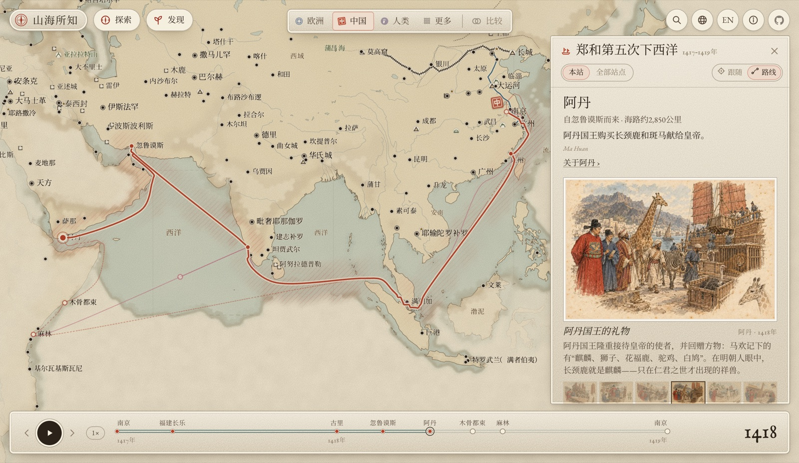
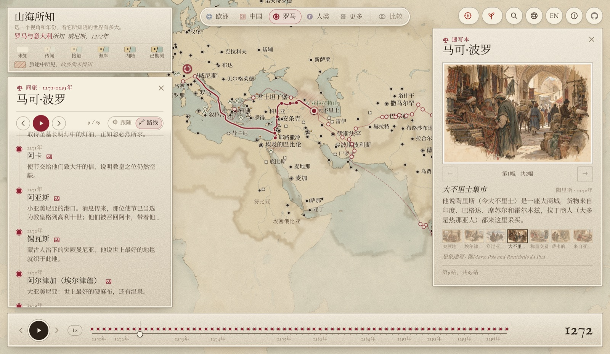

# 山海所知

[English](README.md) · **中文**

**一部关于“谁在何时知道什么”的地图集。** 选一种文化和一个年份，地图就显示那种文化所知晓的世界，其余部分笼罩在迷雾中。跟随那些把知识向外推展的旅人，看消息传回故乡时迷雾散去；知识失传时，迷雾又重新聚拢。

**[打开地图集 →](https://greenere.github.io/the-world-we-know/?lang=zh)** · 中英双语 · 任何现代浏览器均可运行





## 地图集里有什么

- **34个视角。** 每个视角都有自己从公元前2000年到今天的认知史：
  - **中国、朝鲜半岛、日本、漠北、印度、努山塔拉（马来世界）。**
  - **波斯、阿拉伯、埃及、马格里布、土耳其。**
  - **萨赫勒、埃塞俄比亚、斯瓦希里海岸、刚果、南部非洲。**
  - **豪德诺索尼、密西西比世界、墨西加、玛雅、印加、因纽特、波利尼西亚。**
  - **希腊、罗马、伊比利亚、法国、不列颠、德意志、北欧、俄罗斯。**
  - **两个知识共同体：** 欧洲和伊斯兰世界。各自共享其成员所知道的一切。
  - **人类：** 追溯人类最早抵达各地的时间，上溯七万年。
- **184段旅程。** 航海、朝圣、征战、科学考察和最后的边疆，从撒哈拉、西伯利亚到加拿大北极。每段旅程都按陆路、海路和河道规划路线，并标明各个视角从中得知了什么、消息何时传回故乡。许多旅程配有插图速写本。从一段更大的旅程中派出的分队（班超麾下的甘英，马可·波罗出使云南）自成一段旅程，归在所属的旅程之下。
- **148处地标、50处从未失落的遗址，以及69座重新发现的失落之城。**
  - 金字塔、长城、瀑布和火山。一个视角只有在住在附近、亲身遇到，或这个地方已经闻名天下之后，才会知道它。
  - 有些地标覆盖大片土地：沙漠、盐沼，以及几百年间不断萎缩的湖泊，都按真实轮廓绘出。
  - 遗址对住在近旁的人来说从未被遗忘：特奥蒂瓦坎、大津巴布韦和吴哥与那些被世界遗忘后又重新发现的城市分开列出。
  - 有些地标出现得很晚。秘鲁的彩虹山直到2013年冰雪消融后才显出色彩。
  - 有些地标随时间变化。长城按九个朝代绘出，每段城墙在存续时以墨线描绘，荒废越久，颜色越淡。大运河也随时代改道。
  - 城中的奇观（如格拉纳达的阿尔罕布拉宫）列在所在城市的卡片上。
- **82项发明**，改变了人们看待世界的方式，从辐条轮战车到GPS。诞生于某座城市的发明列在该城的卡片上。
- **35种动植物**，以及它们的消息如何传播：玉米从墨西哥传到中国，茶叶经商队和海路传到欧洲，长颈鹿在明朝宫廷被奉为麒麟，渡渡鸟和恐鸟的灭绝。每一种都标有各个视角得知它的年份，并在地图上标出它的到达地点。
- **420部典籍**，本图集所依据的文献：236部当时之作，从希罗多德、《史记》到马欢、伊本·白图泰和达尔文，以及184部今人研究。每部典籍的卡片列出它带来了什么：让各个视角知晓的地域，以及它记述的旅程、地方、发明和动植物。发明中装订成书的几部（如奥特柳斯的地图集）也收在这里。
- **505座城市**的兴起、衰落、被遗忘和重新发现，并以各个视角对它的称呼命名。
- **两个面板。**“探索”收录旅程与地标，“发现”收录发明、典籍与动植物。
- **比较模式**可并排对照两个视角；还有地球仪视图和平面地图，以及标有共同时代的时间轴：从“走出非洲”到“同一张世界地图”。跟随一段旅程时，时间轴变成这段旅程自己的：陆路与海路、标出时长的长期停留，以及消息传回故乡的时刻。

每个视图都是一个链接：`?vp=china&year=1420`、`?vp=europe,china&year=1420`、`?journey=zhenghe&stop=4`、`?city=loulan`、`?invention=magnetic-compass`、`?living=maize&vp=china`、`&globe=1`、`&lang=zh`。

快捷键：← → 关键时刻或旅程站点 · Shift ← → 一年 · 空格 播放 · `/` 搜索 · Esc 关闭。

## 知识如何建模

地图集是一张约41,000个六边形格子的网格（H3，分辨率3）。对每个视角而言，每个格子都有一部认知等级的历史：

| 等级 | 含义 |
| --- | --- |
| 0 | 未知 |
| 1 | 传闻 |
| 2 | 接触 |
| 3 | 海岸已绘 |
| 4 | 内陆已绘 |
| 5 | 已勘测 |

“人类”视角使用自己的等级，从“尚无人至”到“有人居住”。

这部历史按地区写在 [`data/knowledge.csv`](data/knowledge.csv) 中，每次变化一行，每行都有来源和可信度。旅程也会带来新的知识：一段旅程会说明每个视角由此得知了哪些地区、达到什么等级、消息何时传回故乡。

构建过程随后：
- 应用“知道海岸就知道近海”的规则；
- 合并知识共同体的成员；
- 把一切编译成紧凑的逐格变化点，由浏览器绘成动态的迷雾。

数据贯穿几条原则：

- **知识可能失传。** 等级可以下降。格陵兰的北欧殖民地沉寂之后，欧洲对它的认识又退回到传闻。
- **共同体是共享，不是征服。** 成员在加入期间知道共同体所知的一切；它带进来的知识会一直保留，除非有证据表明已被遗忘。
- **知道一个地区，不等于知道其中的一切。** 一处地标为住在附近的人所知，为有记载的到访者所知（630年玄奘到巴米扬，1855年利文斯通到维多利亚瀑布），其余的人只有在它闻名天下之后才会知道。一种动植物从它最早被种植或发现的地方为人所知，各个视角从它传入或被遇到时得知，其余的人则要等它广为人知。
- **每一条都有出处。** 没有来源和可信度的事件、站点、城市或地标，构建会直接拒绝。

## 在本地运行

需要 [Node.js](https://nodejs.org/) 20+ 和 [uv](https://docs.astral.sh/uv/)。uv 会自动配好 Python 构建环境（`h3`、`shapely`、`scipy`）。

```sh
npm install
npm run data     # 把 data/ 编译到 public/data/（首次会下载 Natural Earth 和 ETOPO5）
npm run dev      # http://localhost:5173
```

| 命令 | 作用 |
| --- | --- |
| `npm run data` | 校验并编译 `data/` 中的全部内容，为每段旅程规划路线，并报告中文翻译覆盖率 |
| `npm run build` | 类型检查，并把静态网站写入 `dist/` |
| `npm run typecheck` | 只做类型检查 |
| `npm test` | 运行单元测试 |

网站完全是静态的，`dist/` 可以托管在任何地方。（`npm run deploy` 是维护者发布到 GitHub Pages 的脚本。）

## 项目结构

```
data/            地图上显示的一切，以纯文本编写（要编辑的就是这些文件）
scripts/         build_data.py（数据编译器）、routes.py（旅程路线）、generate_images.py（速写）
src/fog/         H3 网格、迷雾场和自定义迷雾图层
src/map/         底图样式和 deck.gl 叠加层（城市、地标、路线、标签）
src/ui/          顶栏、时间轴、卡片、“探索”和“发现”面板、搜索
src/main.ts      串联：状态、播放、镜头、输入、链接
public/data/     构建输出（自动生成，不提交）
docs/            最初的规格说明，以及研究和图像生成指南
```

地图用 [MapLibre GL](https://maplibre.org/) 和 [deck.gl](https://deck.gl/) 绘制。迷雾是覆盖整个网格的一张三角网格，在 GPU 上混合成柔和、云雾般的边界。界面用纯 TypeScript 编写，不依赖框架。

## 数据

| 文件 | 内容 |
| --- | --- |
| `viewpoints.json` | 每个视角的名称、颜色、历代故乡、关键时刻和共同体成员关系 |
| `regions.geojson` | 约250个命名地区；在这种网格尺度下，粗略的多边形就够了。大地区可以包含小地区（撒哈拉包含西部、中部与东部）：写在大地区上的一行适用于其全境，写在某一部分上的只适用于那一部分 |
| `knowledge.csv` | `viewpoint, region, year, level, confidence, source, note`；年份可以是区间（`1000..1100`），`=n` 表示精确保持某一等级 |
| `journeys/<id>.json` | 站点、每一段的出行方式，以及各个视角从中得知了什么 |
| `cities.csv` | 建立、鼎盛、废弃、被遗忘和重新发现的年份，以及城市的故事 |
| `landmarks.csv` | 人造和自然地标：年份、首次接触（`found`）、何时闻名天下（`widely`）、故事 |
| `landmark-paths.json` | 城墙、运河和峡谷的走向，以及历代重建的年代 |
| `inventions.json` | 器物与思想：时间、地点、人物、改变了什么，以及诞生的城市 |
| `living.json` | 动植物：原产地、哪些视角一开始就知道，以及有年份的传入和遭遇 |
| `names.csv` | 每个视角在何时如何称呼每个地方 |
| `sources.csv` | 引用的每一个来源及其完整出处，并注明它是当时之作、今人研究还是记录，成书年代，以及出自哪个视角 |
| `books.csv` | “典籍”书架上的书，各有简短的作者与书名 |
| `depictions/` | 城市、旅程和发明的想象速写，以及生成它们的提示词和依据的来源 |
| `i18n/zh/` | 以上全部内容的中文；界面文字在 `src/i18n-zh.ts` |

CSV 文件开头有注释说明各自的约定，构建会检查每一处交叉引用。

## 准确性，以及图片是什么

这是一部综合之作。年份和范围都是近似的，许多行仍然引用 `draft` 或 `draft-urban`：这是占位符，意思是“来自常识，有待查证”。把它们换成真正的引用，是任何人能做出的最有用的贡献之一。《奥德赛》这样的传说旅程标注为示意。

城市、旅程场景和发明的速写都是**用图像模型生成的想象插图。** 它们不是历史图像，每张卡片上都标明是想象速写，并记录了生成它的提示词和细节所依据的来源。生成方法见 [docs/image-api-guide.md](docs/image-api-guide.md)。

## 参与贡献

欢迎指正、补充来源和新内容。适合入手的贡献：

- **补一条来源。** 在 `knowledge.csv`、`cities.csv` 或 `landmarks.csv` 中找一行 `draft`，把文献加入 `sources.csv`，再引用它的 id。
- **校正一个视角。** 如果你熟悉某种文化的历史，请对照地图集中它的时间线。每个视角都值得由熟悉它的人审阅，最好来自这一传统内部。
- **添加旅程、地标、发明或动植物。** 复制一个现有条目作为模板，运行 `npm run data`，构建会告诉你缺了什么。
- **翻译。** 中文已完整覆盖；`data/i18n/` 和 `src/i18n-zh.ts` 的结构可作为其他语言的模板。

提交 pull request 之前，请运行 `npm run data` 和 `npm run build`，两者都必须通过。

## 许可

- **代码：** [Mozilla Public License 2.0](LICENSE)。可用于任何项目，无论开源与否；但对这些文件本身的修改须以同一许可证开放。
- **`data/` 中的原创内容：** [CC BY 4.0](data/LICENSE.md)。包括认知表、旅程、地标、发明、动植物、故事、译文和速写。署名“The World We Know（山海所知）”即可再利用。

第三方素材遵循各自的条款：
- **[Natural Earth](https://www.naturalearthdata.com/)（公有领域）：** 海岸线、河流和湖泊，构建时下载。
- **[ETOPO5](https://www.ngdc.noaa.gov/mgg/global/etopo5.HTML)（NOAA，公有领域）：** 用于路线规划的地形高程。
- **字体（SIL Open Font License）：** IM Fell English、EB Garamond 和 Noto Serif SC。
